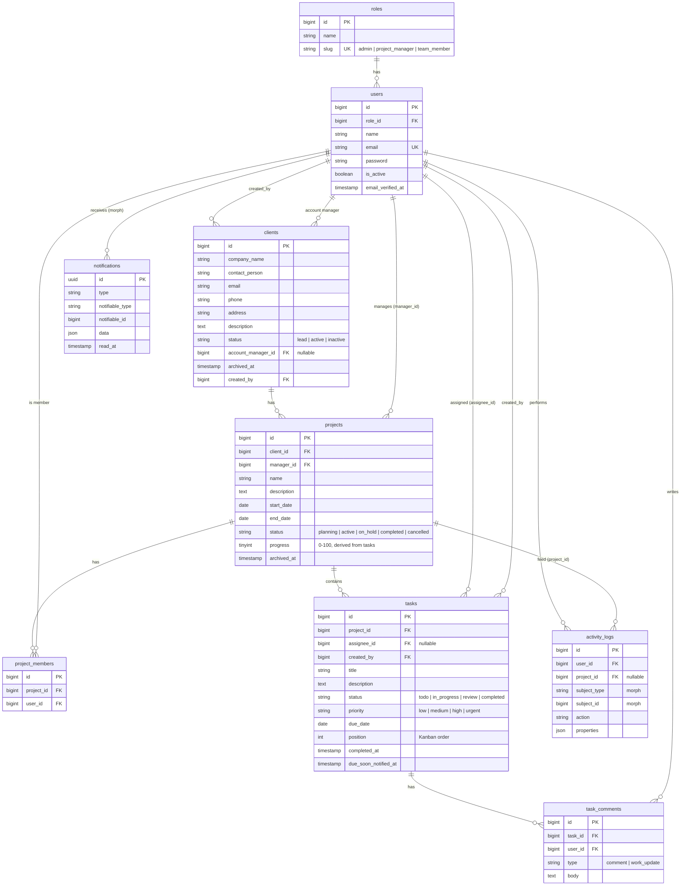

# ClientFlow — Database Design (ERD)

> **Status: approved 2026-11-10** (decisions A–C confirmed — see bottom).

## Diagram

All tables also have `created_at` / `updated_at` (except `roles`, which is static lookup data).

## Relationships (Eloquent)

| Model | Relationship | Notes |
|---|---|---|
| User | `belongsTo(Role)` | one role per user |
| User | `hasMany(Project, 'manager_id')` → `managedProjects` | |
| User | `belongsToMany(Project, 'project_members')` → `projects` | `withTimestamps()` |
| User | `hasMany(Task, 'assignee_id')` → `assignedTasks` | |
| Client | `hasMany(Project)` | |
| Client | `belongsTo(User, 'created_by')` → `creator` | |
| Client | `belongsTo(User, 'account_manager_id')` → `accountManager` | |
| User | `hasMany(Client, 'account_manager_id')` → `managedClients` | |
| Project | `belongsTo(Client)`, `belongsTo(User, 'manager_id')` → `manager` | |
| Project | `belongsToMany(User, 'project_members')` → `members` | |
| Project | `hasMany(Task)`, `hasMany(ActivityLog)` | |
| Task | `belongsTo(Project)`, `belongsTo(User, 'assignee_id')` → `assignee`, `belongsTo(User, 'created_by')` → `creator` | |
| Task | `hasMany(TaskComment)` → `comments` | |
| TaskComment | `belongsTo(Task)`, `belongsTo(User)` → `author` | |
| ActivityLog | `morphTo()` → `subject`, `belongsTo(User)`, `belongsTo(Project)` | |
| User | `Notifiable` trait | Laravel's `notifications` table |

## Delete behavior (foreign keys)

| FK | On delete | Why |
|---|---|---|
| users.role_id | restrict | roles are fixed lookup data |
| projects.client_id | restrict | clients are **archived**, never hard-deleted while projects exist |
| projects.manager_id | restrict | reassign the manager before removing a user |
| project_members.* | cascade | membership is meaningless without either side |
| tasks.project_id | cascade | |
| tasks.assignee_id | null on delete | task survives, becomes unassigned |
| tasks.created_by, clients.created_by | null on delete | keep the record, lose the author link |
| clients.account_manager_id | null on delete | client survives, becomes unassigned |
| task_comments.task_id | cascade | |
| task_comments.user_id | cascade | |
| activity_logs.user_id | null on delete | history survives the user |
| activity_logs.project_id | cascade | |

In practice users are **deactivated** (`is_active = false`), not deleted, so history stays intact.

## Indexes

| Table | Index | Serves |
|---|---|---|
| clients | `(status, archived_at)`, `company_name`, `account_manager_id` | status filter, search, PM scoping |
| projects | `(status, archived_at)`, `manager_id`, `client_id` | list filters, PM scoping |
| project_members | unique `(project_id, user_id)`, `user_id` | "my projects" for members |
| tasks | `(project_id, status)`, `(assignee_id, status)`, `due_date` | Kanban columns, "my tasks", overdue/due-today |
| task_comments | `task_id` | comment thread |
| activity_logs | `(project_id, created_at)`, morph `(subject_type, subject_id)` | project feed, record history |
| notifications | morph `(notifiable_type, notifiable_id)`, `read_at` | bell + unread count |

Foreign keys get indexes automatically in MySQL.

## Design decisions

1. **Statuses/priorities as strings + PHP backed enums**, not MySQL `ENUM` or lookup tables. Adding a value is a code change, not an `ALTER TABLE`; validation and casts share one enum class.
2. **`roles` table, single role per user** (`users.role_id`). The spec lists a `roles` table; a pivot (many roles per user) adds complexity no requirement needs.
3. **Archive = `archived_at` timestamp, not SoftDeletes.** Archived clients/projects are still real data (reports, filters "show archived"); SoftDeletes would hide them from every query by default.
4. **`activity_logs.project_id` is intentional duplication.** A task's project is reachable through the morph, but the dashboard and project page need "all activity for project X" — one indexed column avoids joining through polymorphic subjects.
5. **Notifications use Laravel's built-in table** so `$user->notify()`, `unreadNotifications`, and `markAsRead()` work out of the box.
6. **`tasks.due_soon_notified_at`** prevents the daily deadline job from re-notifying the same task.
7. **`tasks.position`** stores Kanban order within a status column.

## Confirmed decisions (review 2026-11-10)

- **A. Project progress is derived from tasks:** `round(completed / total × 100)`, 0 when a project has no tasks. It is still **stored** in `projects.progress` as a cached value so lists, dashboards and reports don't count tasks per row; the API never accepts it as input. It is recalculated inside the same transaction whenever a task is created, deleted, moved between projects, or changes status.
- **B. Client status:** `lead | active | inactive`. Archiving stays separate (`archived_at`).
- **C. Clients have an explicit account manager:** `clients.account_manager_id` (nullable FK → users). A PM manages the clients assigned to them; they can still *view* clients of projects they manage.
